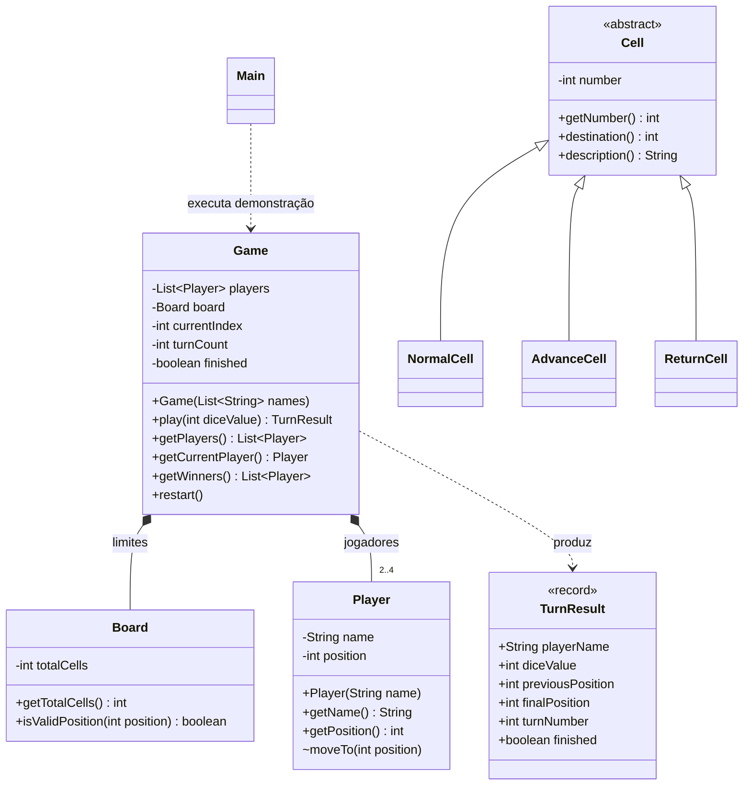
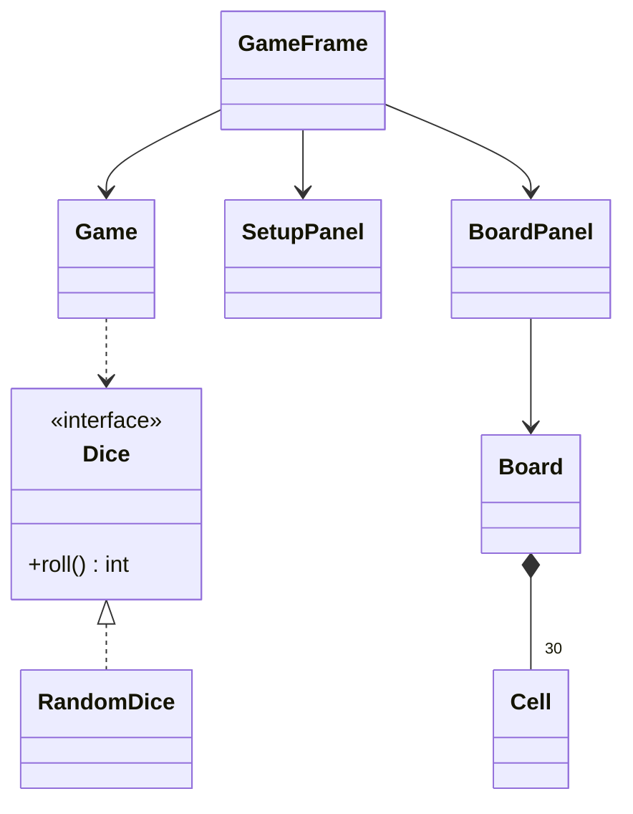

# UML inicial

## Classes existentes e relações atualmente utilizadas

Cell e subclasses existem, mas Board ainda não agrega casas. Essa ligação não é apresentada como implementada.

## Evolução proposta para novembro — ainda não implementada

A futura interface Swing chama o modelo sem conter regras. Dice permitirá substituir lançamentos aleatórios por sequências controladas nos testes. Um possível overload play(Dice), delegando em play(int), será justificado nessa etapa.
